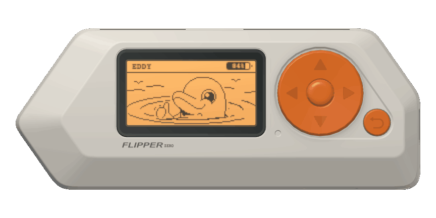

#  Eddy Firmware

 

Eddy is a new firmware for Flipper Zero! Choose the apps you want, arrange them on your Flipper, and try the layout in your browser.

## Download Eddy

Follow the firmware build and installation instructions on the [Eddy website](https://mht3.github.io/eddy-firmware/update/).

## Apps

Available apps include Sub-GHz, RFID, NFC, Infrared, GPIO, iButton, Pomodoro Timer, Metronome, Remotes, and Bluetooth Remote. In Infrared, choose **Learn a remote** to save your own buttons. Saved remotes appear under **My remotes**.

**Infrared → TV presets** opens ready-to-use controls for Samsung TV, LG TV, TCL RC3000E02, and TCL Roku 32S327. Select your TV, point the Flipper at it, and try **Vol −** with **OK**. On Roku, select **D-pad** to use the arrows and OK directly. **Back** returns to the remote. Other TV models may use different codes.

**Remotes** collects your learned infrared remotes and TV presets. Start with one button, add more as you need them, and use the arrows to browse each page. Hold **OK → Add to Apps** to open that layout directly from the launcher.

**Bluetooth Remote** has Camera, Slides, and Media modes. It uses your Flipper’s normal Bluetooth pairing. If this is your first connection, select your Flipper’s name in Bluetooth settings on your phone or Mac. The status line shows the connected device. Hold **OK** on the mode list to give that connection a name. In Camera, open the iPhone Camera app and press **OK** for the shutter. In Slides, start a presentation on the Mac and press **Left / Right**. In Media, use **OK** for play/pause and **Left / Right** for tracks.

## Music integration

Open **Apps → Music** to control Spotify or Apple Music on your paired phone. On iPhone, the Flipper shows the song, artist, and playback time. Press **OK** to play or pause, **Left / Right** for tracks, and **Up / Down** for volume. Compatible Android phones support playback controls. [Bluetooth pairing](https://mht3.github.io/eddy-firmware/bluetooth/)

To test your Spotify developer app, copy its Client ID and include **Spotify** under **Extras** when you install Eddy firmware. Open **Apps → Spotify** on your Flipper and scan the QR code with your iPhone. Install the [Eddy iPhone beta through TestFlight](https://mht3.github.io/eddy-firmware/app/#iphone), then connect your Flipper in Eddy and paste your Client ID when you log in to Spotify. You can then browse playlists, assign them to the four arrows and queue tracks from the Flipper. The website demo lets you try those controls with sample songs. [Try the guided Spotify demo](https://mht3.github.io/eddy-firmware/spotify-demo/) · [Spotify setup](https://mht3.github.io/eddy-firmware/spotify/) · [Flipper app source](https://github.com/mht3/flipper-spotify)

## Acknowledgements

Original Eddy code © 2026 mht3 and contributors. Keep the copyright and license notices when redistributing it. [GNU GPLv3](LICENSE)

I built Eddy on Next-Flip’s Momentum Firmware and the original Flipper Zero firmware. Thank you to the maintainers, artists, and contributors of both projects. This repository retains their history, copyright notices, and licenses. [Momentum Firmware](https://github.com/Next-Flip/Momentum-Firmware) · [Flipper Zero firmware](https://github.com/flipperdevices/flipperzero-firmware)
