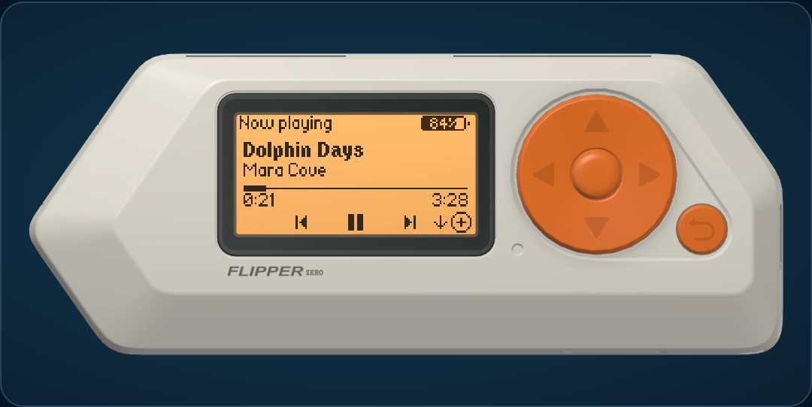

#  Eddy Firmware

 

Eddy is a new firmware for Flipper Zero! Choose the apps you want, arrange them on your Flipper, and try the layout in your browser.

## Download Eddy

Follow the firmware build and installation instructions on the [Eddy website](https://mht3.github.io/eddy-firmware/update/).

## Apps

Available apps include Sub-GHz, RFID, NFC, Infrared, GPIO, iButton, Pomodoro Timer, Metronome, Remote Builder, and Bluetooth Remote. In Infrared, choose **Learn a remote** to save your own buttons. Saved remotes appear under **My remotes**.

**Infrared → TV presets** opens ready-to-use controls for Samsung TV, LG TV, TCL RC3000E02, and TCL Roku 32S327. Select your TV, point the Flipper at it, and try **Vol −** with **OK**. On Roku, select **D-pad** to use the arrows and OK directly. **Back** returns to the remote. Other TV models may use different codes.

**Remote Builder** lets you name a remote, pick a position on its six-button grid, and teach it a button from an infrared remote. Hold **OK → Add to Apps** to open that layout directly from the launcher.

**Bluetooth Remote** has Camera, Slides, and Media modes. Open the app and pair the name shown at the bottom of the screen in your iPhone or Mac Bluetooth settings. The status line shows the current peer address. Hold **OK** on the mode list to give that connection a name. In Camera, open the iPhone Camera app and press **OK** for the shutter. In Slides, start a presentation on the Mac and press **Left / Right**. In Media, use **OK** for play/pause and **Left / Right** for tracks.

## Music integration

Open **Apps → Music** to control Spotify or Apple Music on your paired phone. On iPhone, the Flipper shows the song, artist, and playback time. Press **OK** to play or pause, **Left / Right** for tracks, and **Up / Down** for volume. Compatible Android phones support playback controls. [Music guide](https://mht3.github.io/eddy-firmware/music/) · [Bluetooth pairing](https://mht3.github.io/eddy-firmware/bluetooth/)

The separate **Spotify** app browses Liked Songs, playlists, and saved albums four items at a time. Press OK to play a selection on your active Spotify device. Try it with a sample library in the emulator. Personal account linking is currently available to the developer and invited testers. Playback requires Spotify Premium and a connected browser with Web Bluetooth, such as Chrome on a Mac, PC, or Android phone. [Try the library](https://mht3.github.io/eddy-firmware/?demo=spotify#home-screen) · [Spotify guide](https://mht3.github.io/eddy-firmware/spotify/)

## Acknowledgements

I built Eddy on Next-Flip’s Momentum Firmware and the original Flipper Zero firmware. Thank you to the maintainers, artists, and contributors of both projects. This repository retains their history, copyright notices, and licenses. [Momentum Firmware](https://github.com/Next-Flip/Momentum-Firmware) · [Flipper Zero firmware](https://github.com/flipperdevices/flipperzero-firmware)
